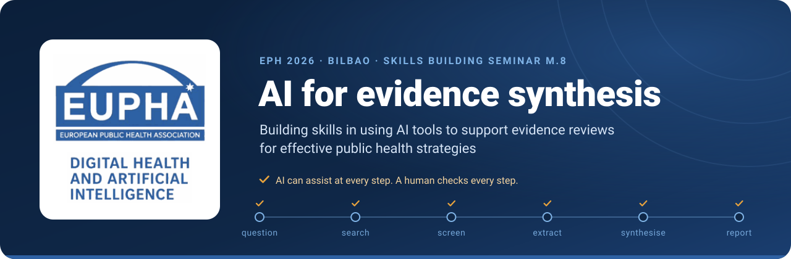
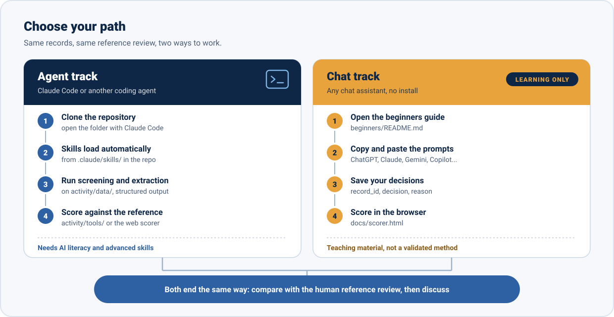
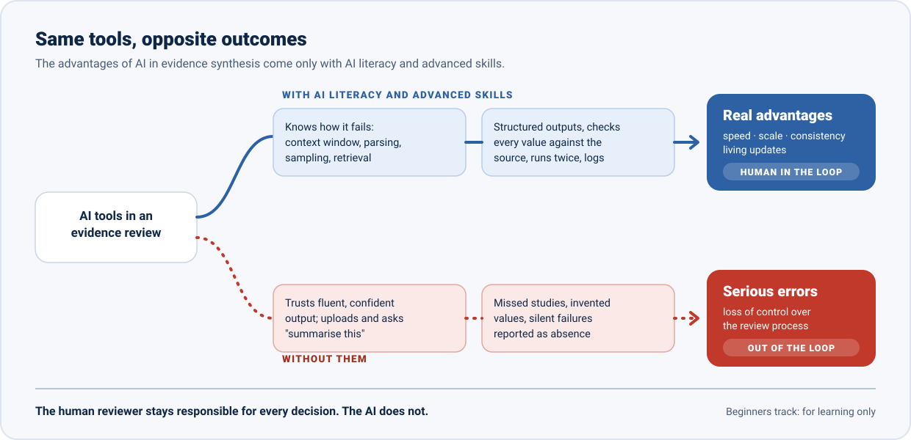

<a href="https://fraba94.github.io/eph2026-ai-for-evidence-synthesis/"></a>

<p align="center">
  <a href="https://fraba94.github.io/eph2026-ai-for-evidence-synthesis/"></a>
  <a href="#organisers-and-speakers"></a>
  <a href="LICENSE"></a>
  <a href="skills/README.md"></a>
  <a href="beginners/README.md"></a>
</p>

**Hands-on materials for using AI to screen studies and extract data in an evidence review, and for checking it against a review conducted without AI.** Skills building seminar of the EUPHA Digital Health and Artificial Intelligence Section at the European Public Health Conference 2026, Bilbao.

<p align="center">
  <a href="activity/README.md"></a>
  <a href="beginners/README.md"></a>
  <a href="https://fraba94.github.io/eph2026-ai-for-evidence-synthesis/batch.html"></a>
  <a href="prompts/README.md"></a>
  <a href="skills/README.md"></a>
  <a href="https://fraba94.github.io/eph2026-ai-for-evidence-synthesis/scorer.html"></a>
  <a href="https://fraba94.github.io/eph2026-ai-for-evidence-synthesis/"></a>
  <a href="docs/slides/README.md"></a>
</p>

## Choose your path



| | **Agent track** | **Chat track** |
|---|---|---|
| **For** | People who already use Claude Code or another coding agent, and know how to check its work | Everyone else: any chat assistant (ChatGPT, Claude, Gemini, Copilot, Mistral...), no installation |
| **Start** | [Quick start for agents](#quick-start-for-agents) | [AI beginners track](beginners/README.md) |
| **Records** | [`activity/data/`](activity/README.md) | [Copy-ready batches](https://fraba94.github.io/eph2026-ai-for-evidence-synthesis/batch.html) (abstracts fetched from PubMed in your browser) |
| **Score** | `activity/tools/score_*.py` or the [web scorer](https://fraba94.github.io/eph2026-ai-for-evidence-synthesis/scorer.html) | The [web scorer](https://fraba94.github.io/eph2026-ai-for-evidence-synthesis/scorer.html): nothing is uploaded |
| **Status** | Needs AI literacy and advanced skills | **For learning only** |

## The key message



AI can bring real advantages to evidence synthesis (speed, scale, consistency, living updates), **but only for people with AI literacy and advanced skills.** Whoever does not understand how these systems work risks serious errors and losing control of the process, ending up out of the loop. Human reviewers stay responsible for every decision.

> [!WARNING]
> ⚠️ **For learning only.** These prompts are teaching material for this workshop. They are not a validated method.
> If you are not confident with how large language models work (context windows, parsing, sampling, retrieval,
> hallucination) and with advanced techniques (structured outputs, verification against the source, reproducibility
> checks, documentation of model and version), **do not use AI to conduct a real evidence review.** You stay
> responsible for every decision: the AI does not.

<details>
<summary><b>Where AI can help, and where a human must check</b> (review workflow diagram)</summary>
<br>


Guidance to rely on: the [position statement on AI use in evidence synthesis across Cochrane, the Campbell Collaboration, JBI and the Collaboration for Environmental Evidence (2025)](https://doi.org/10.1186/s13750-025-00374-5) and [RAISE, Responsible use of AI in evidence SynthEsis](https://osf.io/fwaud/).
</details>

## Session at a glance

| Time | Part | What happens |
|---:|---|---|
| 10 min | **Expert discussion** | Limitations first, with Patrick Boudreau (about 5 min), then benefits, with Francesco Baglivo (about 5 min) |
| 10 min | **Demo** | Selected open-access AI tools for evidence reviews |
| 30 min | **Small-group exercise** | Screening and data extraction with AI, compared with a review conducted without AI ([activity guide](activity/README.md)) |
| 10 min | **Structured discussion** | Performance, transparency, bias and human oversight |

**Learning objectives.** (1) Apply AI tools to screening and data extraction within a structured review workflow. (2) Compare AI-assisted outputs with manual results and identify discrepancies. (3) Critically assess risks, limitations and appropriate use of AI in evidence synthesis.

## The exercise

The question is deliberately uncontroversial, so that the focus stays on the AI method: **how effective are hand hygiene interventions in preventing healthcare-associated infections?** The reference standard is a published systematic review on hand hygiene and healthcare-associated infections, **screened, extracted and synthesised by human reviewers without AI**. The choice of review is provisional (details and limits in [`activity/data/README.md`](activity/data/README.md)), and the extraction reference values were prepared by the workshop team from the full texts and cross-checked with the review's own tables. In small groups you screen a set of records and extract data with AI, then [score](https://fraba94.github.io/eph2026-ai-for-evidence-synthesis/scorer.html) your results against the human decisions and discuss where, and why, they differ: missed studies, invented values, "not reported" when the information is there, different answers on a second run. The reference review, the eligibility criteria and the steps are in the [activity guide](activity/README.md).

## Quick start for agents

```bash
git clone https://github.com/fraba94/eph2026-ai-for-evidence-synthesis
cd eph2026-ai-for-evidence-synthesis
claude          # open the folder with Claude Code
```

When Claude Code opens the folder it reads [`CLAUDE.md`](CLAUDE.md) and [`AGENTS.md`](AGENTS.md), and the seven skills in [`.claude/skills/`](.claude/skills/) load automatically: Claude uses one when your request matches its description, or you can call it by name (for example `/title-abstract-screening`).

| Skill | Use it to |
|---|---|
| `review-protocol-check` | turn the question into PICO and explicit eligibility criteria before anything else |
| `search-strategy-critic` | break a search strategy, not improve it |
| `title-abstract-screening` | screen twice, with a reason per record, and merge conservatively |
| `full-text-extraction` | fill a form designed first, with a verbatim quote and location for every value |
| `quote-verifier` | check every quote and number against the source |
| `discrepancy-audit` | compare with the reference review and classify each error |
| `ai-use-reporting` | document model, version, prompts and checks for the methods section |

Other agents (Codex CLI, Gemini CLI, Cursor, Copilot...) read [`AGENTS.md`](AGENTS.md); the catalogue and installation notes are in [`skills/README.md`](skills/README.md).

## Quick start for AI beginners

1. Read the warning above, then open the [AI beginners track](beginners/README.md).
2. Copy a batch of records from the [records page](https://fraba94.github.io/eph2026-ai-for-evidence-synthesis/batch.html) and paste it into your chat after the screening prompt.
3. Save the answer as `record_id,decision,reason` and load it into the [scorer](https://fraba94.github.io/eph2026-ai-for-evidence-synthesis/scorer.html).
4. Bring your missed includes and your surprises to the discussion.

## Repository map

<details>
<summary>What is where</summary>

```text
eph2026-ai-for-evidence-synthesis/
├── README.md             ← you are here
├── activity/             ← the hands-on guide, records, extraction form, scoring scripts
│   ├── README.md
│   ├── data/             ← screening_records.csv, extraction_form.csv
│   ├── answers/          ← reference answers: open only when you score
│   └── tools/            ← score_screening.py, score_extraction.py
├── beginners/            ← AI beginners track (for learning only)
├── prompts/              ← prompt library for chat assistants, by review stage
├── skills/README.md      ← catalogue of the agent skills
├── .claude/skills/       ← the Claude Code skills (auto-loaded)
├── AGENTS.md, CLAUDE.md  ← rules for any coding agent opened here
├── docs/                 ← website: landing page, records page, scorer (GitHub Pages)
├── assets/               ← logo, banner, buttons, diagrams
└── LICENSE, LICENSE-CODE, CITATION.cff
```
</details>

## Organisers and speakers

Organised by the **EUPHA Digital Health and Artificial Intelligence (DHAI) Section** with **Concordia University** (Canada), the **Leibniz ScienceCampus Digital Public Health Bremen** (Germany) and the **Italian Society for AI in Medicine (SIIAM)**.

| Role | Person |
|---|---|
| Chair and contact | **Laura Maaß**, EUPHA Digital Health and Artificial Intelligence Section |
| Speaker, limitations | **Patrick Boudreau**, Montreal Behavioural Medicine Centre, Concordia University |
| Speaker, benefits | **Francesco Baglivo**, University of Pisa |

Abstract: *Eur J Public Health* 2026;36(Suppl 5):ckag169.470, [on the journal website](https://academic.oup.com/eurpub/article/36/Supplement_5/ckag169.470/8995443).

## How to cite

Use the **Cite this repository** button on GitHub, which reads [`CITATION.cff`](CITATION.cff), or:

> EUPHA Digital Health and Artificial Intelligence Section, Baglivo F. *AI for evidence synthesis: materials for the EPH 2026 skills building seminar M.8.* 2026. https://github.com/fraba94/eph2026-ai-for-evidence-synthesis

## Licences

<details>
<summary>Content CC BY 4.0, code MIT, with exceptions</summary>

- **Content** (texts, prompts, skills, guides, diagrams): [Creative Commons Attribution 4.0 International](LICENSE) (CC BY 4.0).
- **Code** (`.py`, `.js`, `.html`, `.css` files, including the scripts in `.claude/skills/`): [MIT](LICENSE-CODE).
- **Not covered:** the EUPHA and EUPHA DHAI logo (`assets/eupha-dhai-logo.png` and its copies), used to identify the section, which may not be reused without EUPHA's permission; bibliographic records, abstracts and articles of third parties, which keep their own licences and copyright (see the `license` column of the data files).
</details>

## Contact

EUPHA Digital Health and Artificial Intelligence Section: [euphadhai@gmail.com](mailto:euphadhai@gmail.com). Problems with the materials or a prompt to share: [open an issue](https://github.com/fraba94/eph2026-ai-for-evidence-synthesis/issues/new/choose).
