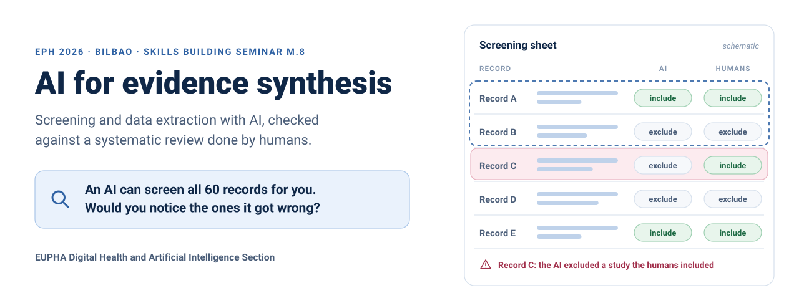
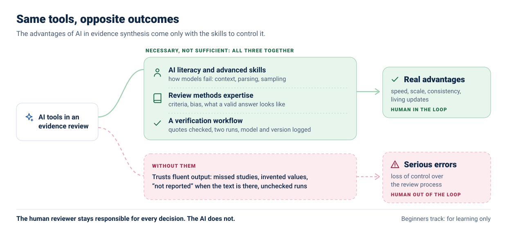
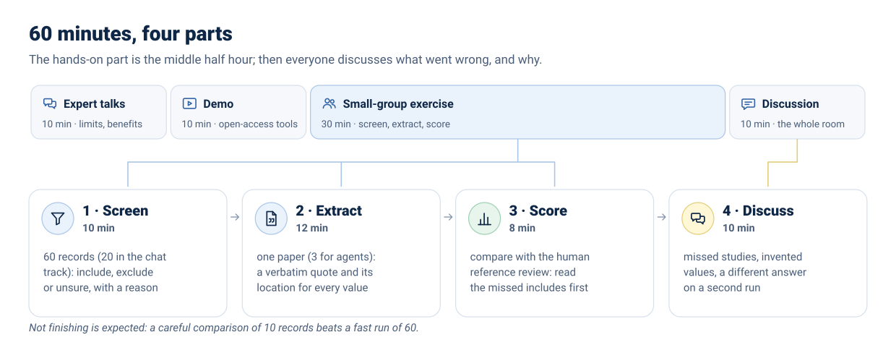
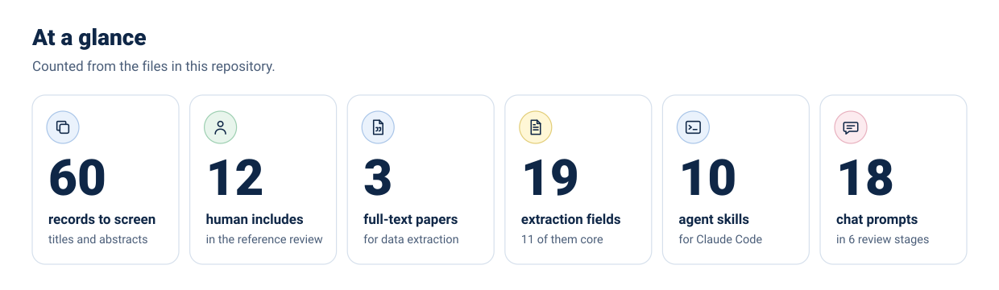
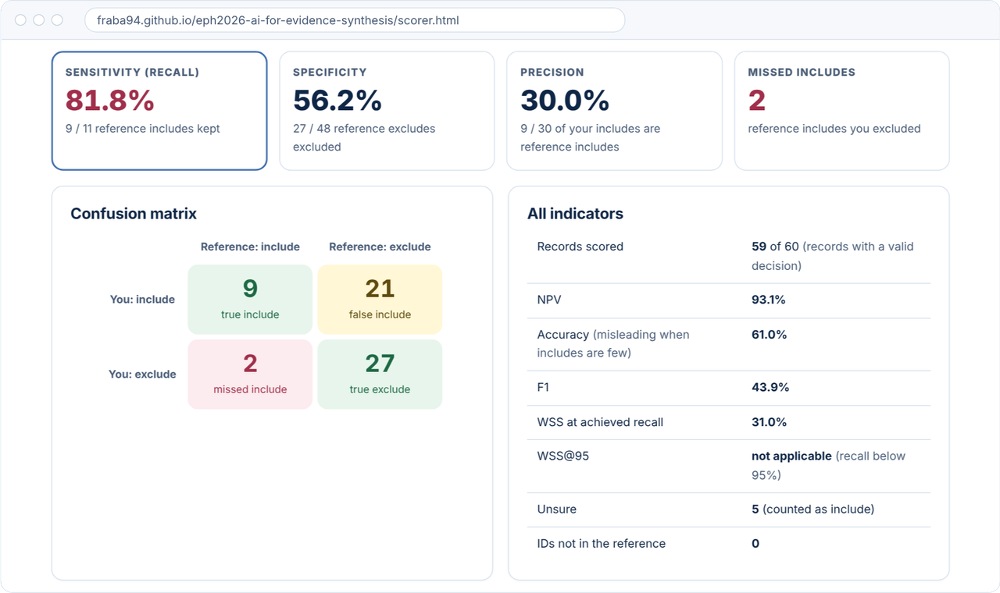
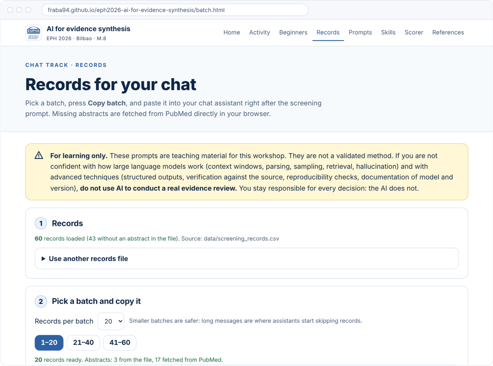
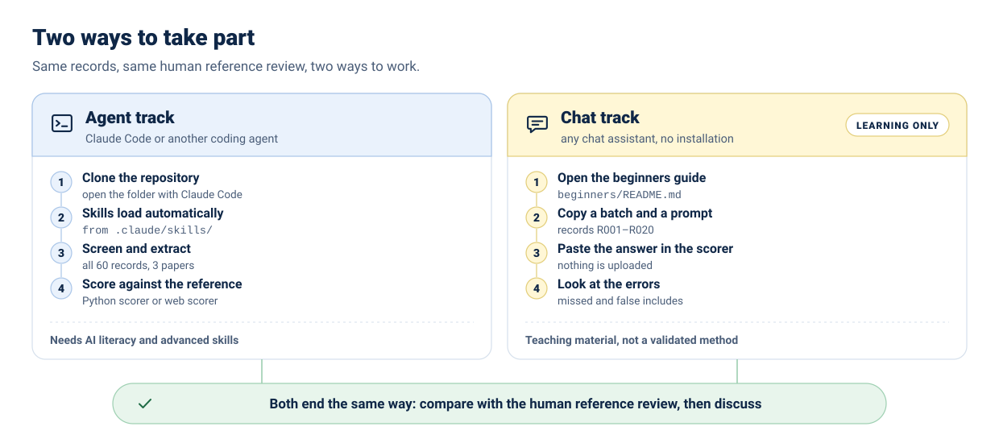
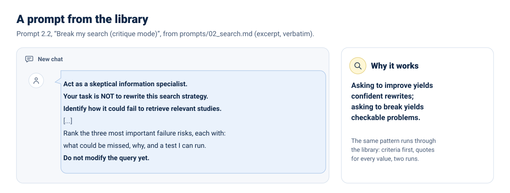

<a href="https://fraba94.github.io/eph2026-ai-for-evidence-synthesis/"><picture>
  <source media="(max-width: 700px) and (prefers-color-scheme: dark)" srcset="assets/figures/hero-mobile-dark.svg">
  <source media="(max-width: 700px)" srcset="assets/figures/hero-mobile-light.svg">
  <source media="(prefers-color-scheme: dark)" srcset="assets/figures/hero-dark.svg">
  
</picture></a>

**Hands-on materials for screening studies and extracting data with AI, and for checking the result against a systematic review done by humans.** Skills building seminar of the EUPHA Digital Health and Artificial Intelligence Section at the European Public Health Conference 2026, Bilbao.

<p align="center">
  <a href="activity/README.md"><picture><source media="(prefers-color-scheme: dark)" srcset="assets/buttons/activity-dark.svg"></picture></a>
  <a href="beginners/README.md"><picture><source media="(prefers-color-scheme: dark)" srcset="assets/buttons/beginners-dark.svg"></picture></a>
  <a href="https://fraba94.github.io/eph2026-ai-for-evidence-synthesis/batch.html"><picture><source media="(prefers-color-scheme: dark)" srcset="assets/buttons/records-dark.svg"></picture></a>
  <a href="https://fraba94.github.io/eph2026-ai-for-evidence-synthesis/scorer.html"><picture><source media="(prefers-color-scheme: dark)" srcset="assets/buttons/scorer-dark.svg"></picture></a>
  <a href="prompts/README.md"><picture><source media="(prefers-color-scheme: dark)" srcset="assets/buttons/prompts-dark.svg"></picture></a>
  <a href="skills/README.md"><picture><source media="(prefers-color-scheme: dark)" srcset="assets/buttons/skills-dark.svg"></picture></a>
</p>

<p align="center">
  <a href="https://fraba94.github.io/eph2026-ai-for-evidence-synthesis/"><b>Workshop website</b></a> &nbsp;·&nbsp;
  <a href="REFERENCES.md"><b>Useful references</b></a> &nbsp;·&nbsp;
  <a href="docs/slides/README.md"><b>Slides and abstract</b></a> &nbsp;·&nbsp;
  <a href="#quick-start-for-agents"><b>Quick start</b></a>
</p>

## The key message

<picture>
  <source media="(max-width: 700px) and (prefers-color-scheme: dark)" srcset="assets/figures/key-message-mobile-dark.svg">
  <source media="(max-width: 700px)" srcset="assets/figures/key-message-mobile-light.svg">
  <source media="(prefers-color-scheme: dark)" srcset="assets/figures/key-message-dark.svg">
  
</picture>

AI can bring real advantages to evidence synthesis (speed, scale, consistency, living updates), **but only to people with AI literacy and advanced skills.** Those skills are necessary, not sufficient: they work together with review methods expertise and a verification workflow. Without them come serious errors and loss of control, and the human drops out of the loop. Human reviewers stay responsible for every decision.

> [!WARNING]
> **For learning only.** These prompts are teaching material for this workshop. They are not a validated method.
> If you are not confident with how large language models work (context windows, parsing, sampling, retrieval,
> hallucination) and with advanced techniques (structured outputs, verification against the source, reproducibility
> checks, documentation of model and version), **do not use AI to conduct a real evidence review.** You stay
> responsible for every decision: the AI does not.

## How the session works

<picture>
  <source media="(prefers-color-scheme: dark)" srcset="assets/figures/session-dark.svg">
  
</picture>

**The exercise.** The question is deliberately uncontroversial, so the focus stays on the AI method: *how effective are hand hygiene interventions in preventing healthcare-associated infections?* The reference standard is the review by **Pruna et al.** (*J Clin Med*, 2026), a systematic review of quasi-experimental studies in acute care hospitals with 12 included studies, screened and extracted by two independent human reviewers without AI ([doi:10.3390/jcm15103882](https://doi.org/10.3390/jcm15103882)). The choice is provisional; details and limits are in [`activity/data/README.md`](activity/data/README.md). You screen a set of records and extract data with AI, then score your results against the human decisions and discuss where, and why, they differ: missed studies, invented values, "not reported" when the information is there, a different answer on a second run. The criteria and the steps are in the [activity guide](activity/README.md).

<details>
<summary><b>Learning objectives</b></summary>

1. Apply AI tools to screening and data extraction within a structured review workflow.
2. Compare AI-assisted outputs with manual results and identify discrepancies.
3. Critically assess risks, limitations and appropriate use of AI in evidence synthesis.
</details>

<picture>
  <source media="(prefers-color-scheme: dark)" srcset="assets/figures/at-a-glance-dark.svg">
  
</picture>

## See it before the session

The website gives the chat track everything without installing anything: the records in copy-ready batches (abstracts that the repository cannot ship are fetched from PubMed in your browser) and a scorer that compares your decisions with the reference review. Shown here with the fake decisions of [`activity/examples/`](activity/examples/README.md).

<a href="https://fraba94.github.io/eph2026-ai-for-evidence-synthesis/scorer.html"></a>
<p align="center"><sub>The scorer with the example file: the same numbers as <code>python3 activity/tools/score_screening.py activity/examples/decisions_example.csv</code></sub></p>

<details>
<summary><b>The records page</b> (screenshot)</summary>
<br>
<a href="https://fraba94.github.io/eph2026-ai-for-evidence-synthesis/batch.html"></a>
</details>

## Choose your path

<picture>
  <source media="(prefers-color-scheme: dark)" srcset="assets/figures/tracks-dark.svg">
  
</picture>

<details>
<summary><b>The two tracks side by side</b></summary>
<br>

| | **Agent track** | **Chat track** |
|---|---|---|
| **For** | People who already use Claude Code or another coding agent, and know how to check its work | Everyone else: any chat assistant (ChatGPT, Claude, Gemini, Copilot, Mistral...), no installation |
| **Start** | [Quick start for agents](#quick-start-for-agents) | [AI beginners track](beginners/README.md) |
| **Records** | [`activity/data/`](activity/README.md), all 60 | [Copy-ready batches](https://fraba94.github.io/eph2026-ai-for-evidence-synthesis/batch.html), R001-R020 |
| **Score** | `activity/tools/score_*.py` or the [web scorer](https://fraba94.github.io/eph2026-ai-for-evidence-synthesis/scorer.html) | The [web scorer](https://fraba94.github.io/eph2026-ai-for-evidence-synthesis/scorer.html): nothing is uploaded |
| **Status** | Needs AI literacy and advanced skills | **For learning only** |
</details>

### Quick start for agents

```bash
git clone https://github.com/fraba94/eph2026-ai-for-evidence-synthesis
cd eph2026-ai-for-evidence-synthesis
claude          # open the folder with Claude Code
```

When Claude Code opens the folder it reads [`CLAUDE.md`](CLAUDE.md) and [`AGENTS.md`](AGENTS.md), and the ten skills in [`.claude/skills/`](.claude/skills/) load automatically: Claude uses one when your request matches its description, or you can call it by name (for example `/title-abstract-screening`). Other agents (Codex CLI, Gemini CLI, Cursor, Copilot...) read [`AGENTS.md`](AGENTS.md). Looking for more skills? [`skills/EXTERNAL.md`](skills/EXTERNAL.md) is a curated list of external collections, with a security note: read it before installing anything.

<details>
<summary><b>The ten skills, one line each</b></summary>
<br>

| Skill | Use it to |
|---|---|
| `review-protocol-check` | turn the question into PICO and explicit eligibility criteria before anything else |
| `search-strategy-critic` | break a search strategy, not improve it |
| `title-abstract-screening` | screen twice, with a reason per record, and merge conservatively |
| `full-text-extraction` | fill a form designed first, with a verbatim quote and location for every value |
| `quote-verifier` | check every quote and number against the source |
| `discrepancy-audit` | compare with the reference review and classify each error |
| `risk-of-bias-assessment` | collect the evidence for each ROBINS-I or RoB 2 domain, with quotes; humans judge |
| `grade-certainty` | draft the GRADE reasons per outcome; the team rates |
| `prisma-reporting-check` | check a review against PRISMA 2020, item by item, with quotes |
| `ai-use-reporting` | document model, version, prompts and checks for the methods section |

Catalogue and installation notes: [`skills/README.md`](skills/README.md).
</details>

### Quick start for AI beginners

1. Read the warning above, then open the [AI beginners track](beginners/README.md).
2. Copy a batch of records from the [records page](https://fraba94.github.io/eph2026-ai-for-evidence-synthesis/batch.html) and paste it into your chat after the screening prompt.
3. Save the answer as `record_id,decision,reason` and load it into the [scorer](https://fraba94.github.io/eph2026-ai-for-evidence-synthesis/scorer.html).
4. Bring your missed includes and your surprises to the discussion.

## Inside the repository

<a href="skills/README.md"><picture>
  <source media="(prefers-color-scheme: dark)" srcset="assets/figures/review-map-dark.svg">
  
</picture></a>

<a href="prompts/02_search.md"><picture>
  <source media="(prefers-color-scheme: dark)" srcset="assets/figures/prompt-card-dark.svg">
  
</picture></a>

<details>
<summary><b>Repository map</b></summary>

```text
eph2026-ai-for-evidence-synthesis/
├── README.md             ← you are here
├── REFERENCES.md         ← useful references, verified
├── activity/             ← the hands-on guide, records, extraction form, scoring scripts
│   ├── README.md
│   ├── data/             ← screening_records.csv, extraction_form.csv
│   ├── answers/          ← reference answers: open only when you score
│   └── tools/            ← score_screening.py, score_extraction.py
├── beginners/            ← AI beginners track (for learning only)
├── prompts/              ← prompt library for chat assistants, by review stage
├── skills/               ← catalogue of the agent skills, external collections (EXTERNAL.md), attribution
├── .claude/skills/       ← the Claude Code skills (auto-loaded)
├── AGENTS.md, CLAUDE.md  ← rules for any coding agent opened here
├── docs/                 ← website: landing page, records page, scorer, references (GitHub Pages)
├── assets/               ← figures (and the script that builds them), buttons, logos, screenshots
└── LICENSE, LICENSE-CODE, CITATION.cff
```

The figures are built from the repository files by `python3 assets/figures/build_figures.py`, so the numbers they show are counted, not typed; `python3 docs/sync_data.py` then copies them into the website.
</details>

## Useful references

Five starting points; the [full list](REFERENCES.md) has 25 references checked on PubMed and Crossref, each introduced by its design and sample before what it found.

- **Flemyng et al., *Campbell Syst Rev* 2025.** Joint position statement of Cochrane, the Campbell Collaboration, JBI and the Collaboration for Environmental Evidence: reviewers stay responsible, AI is used with human oversight and reported. [doi:10.1002/cl2.70074](https://doi.org/10.1002/cl2.70074)
- **Fleurence et al., *Value Health* 2026.** ISPOR task-force good-practices report built on 115 empirical studies and expert consensus: AI inside human-in-the-loop workflows, not autonomous reviews. [doi:10.1016/j.jval.2026.08.007](https://doi.org/10.1016/j.jval.2026.08.007)
- **Adam et al., *Res Synth Methods* 2026.** Living rapid review of 134 studies of AI tools for evidence synthesis; the authors conclude that no existing tool can replace human expertise. [doi:10.1017/rsm.2026.10118](https://doi.org/10.1017/rsm.2026.10118)
- **Gartlehner et al., *Ann Intern Med* 2025.** Study within 6 ongoing systematic reviews comparing extraction by Claude, verified by a human, with human-only extraction. [doi:10.7326/ANNALS-25-00739](https://doi.org/10.7326/ANNALS-25-00739)
- **Qazi et al., *NEJM AI* 2026.** Randomised trial with 44 physicians trained in AI literacy: erroneous ChatGPT-4o suggestions lowered their diagnostic accuracy. Literacy is necessary, not sufficient. [doi:10.1056/AIoa2501001](https://doi.org/10.1056/AIoa2501001)

<p><a href="REFERENCES.md"><picture><source media="(prefers-color-scheme: dark)" srcset="assets/buttons/references-dark.svg"></picture></a></p>

## Organisers and speakers

Organised by the **EUPHA Digital Health and Artificial Intelligence (DHAI) Section** with **Concordia University** (Canada), the **Leibniz ScienceCampus Digital Public Health Bremen** (Germany) and the **Italian Society for AI in Medicine (SIIAM)**.

| Role | Person |
|---|---|
| Chair and contact | **Laura Maaß**, EUPHA Digital Health and Artificial Intelligence Section |
| Speaker, limitations | **Patrick Boudreau**, Montreal Behavioural Medicine Centre, Concordia University |
| Speaker, benefits | **Francesco Baglivo**, University of Pisa |

<p align="center"></p>

Abstract: *Eur J Public Health* 2026;36(Suppl 5):ckag169.470, [on the journal website](https://academic.oup.com/eurpub/article/36/Supplement_5/ckag169.470/8995443).

## How to cite

Use the **Cite this repository** button on GitHub, which reads [`CITATION.cff`](CITATION.cff), or:

> EUPHA Digital Health and Artificial Intelligence Section, Baglivo F. *AI for evidence synthesis: materials for the EPH 2026 skills building seminar M.8.* 2026. https://github.com/fraba94/eph2026-ai-for-evidence-synthesis

## Licences

<details>
<summary>Content CC BY 4.0, code MIT, with exceptions</summary>

- **Content** (texts, prompts, skills, guides, diagrams): [Creative Commons Attribution 4.0 International](LICENSE) (CC BY 4.0).
- **Code** (`.py`, `.js`, `.html`, `.css` files, including the scripts in `.claude/skills/` and `assets/figures/build_figures.py`): [MIT](LICENSE-CODE).
- **Not covered:** the logos of the EUPHA Digital Health and Artificial Intelligence Section, Concordia University, the Leibniz ScienceCampus Digital Public Health Bremen, SIIAM and the University of Pisa (`assets/eupha-dhai-logo.png`, `assets/logos/`, their copies in `docs/assets/`, and `assets/social-preview.png`), used only to identify the organisers and the speakers' institutions, which may not be reused without their owners' permission; bibliographic records, abstracts and articles of third parties, which keep their own licences and copyright (see the `license` column of the data files).
</details>

## Contact

EUPHA Digital Health and Artificial Intelligence Section: [euphadhai@gmail.com](mailto:euphadhai@gmail.com). Problems with the materials or a prompt to share: [open an issue](https://github.com/fraba94/eph2026-ai-for-evidence-synthesis/issues/new/choose).
